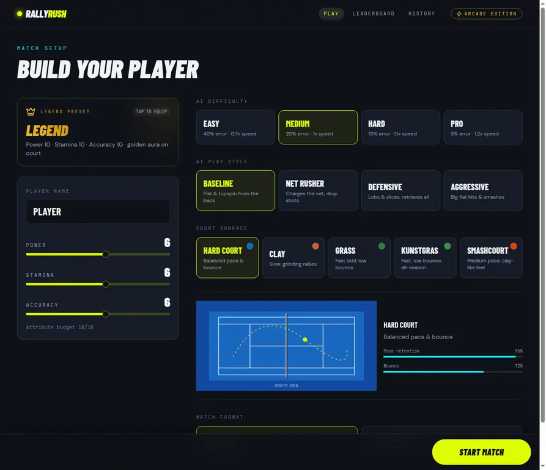
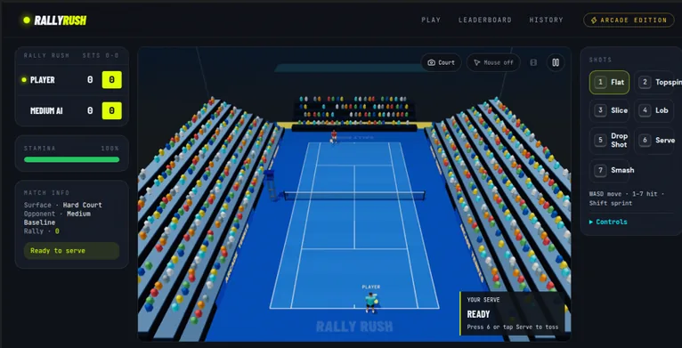

# Rally Rush

[](https://github.com/Rengerams/RallyRush/releases)
[](https://github.com/Rengerams/RallyRush/releases)
[](https://opensource.org/licenses/MIT)
[](#windows-desktop)
[](#run-from-source)
[](#features)

Rally Rush is a single-player, arcade-style 3D tennis game for Windows and the browser. Play fast matches against AI opponents, build a player, and master seven shot types across five court surfaces.

> Local play only: matches, match history, and leaderboard entries are saved on this device. There is no online multiplayer, account system, or shared online ranking.

- Homepage: https://github.com/Rengerams/RallyRush
- Changelog & releases: https://github.com/Rengerams/RallyRush/releases

## Screenshots

### Match setup



### Gameplay



## Table of contents

- [Features](#features)
- [What’s new in 0.3.0](#whats-new-in-030)
- [Screenshots](#screenshots)
- [Download (Windows)](#windows-desktop)
- [Controls](#controls)
- [Run from source](#run-from-source)
- [Build and test](#build-and-test)
- [Project layout](#project-layout)
- [Contributing](#contributing)
- [Reporting bugs & feedback](#reporting-bugs--feedback)
- [Roadmap](#next-version)
- [License](#license)

## What’s new in 0.3.0

Rally Rush 0.3.0 is all about getting into the match faster, seeing more of the court, and making every rally feel clearer. The release is still in validation; these are the features in the 0.3.0 update.

### Find your feet, then find your game

- A short, skippable first-session guide teaches movement, sprinting, sliding, shot choice, timing, and the scoreboard. Replay it from Setup or Pause whenever you need a refresher.
- Three Practice drills let you sharpen your timing, work on your serve, or aim at a chosen court lane. Practice attempts stay out of match history and leaderboard results.
- Clearer control hints help keyboard, mouse, and touch players get started.

### The court takes center stage

- A larger, responsive match view gives the court and stadium more room while keeping the action framed.
- Follow points, games, sets, and the active server between rallies, with a compact score display during play.
- Editable quick-play presets set the surface, AI style, difficulty, and match format; you can still customize your player and match.
- Improved keyboard focus, contrast, and screen-reader announcements make match feedback easier to follow, with reduced-motion support for callouts.

### Rallies with a little more rhythm

- Tuned acceleration, turning, sliding, recovery, and stamina make movement feel more deliberate.
- Contact, spin, and court-surface bounce have been tuned alongside gameplay stability.
- AI difficulty has a repeatable playtest baseline across matchups.

### Replay the point. Learn from the match.

- Pause or resume replays and choose playback speed.
- Review the final point and get a post-match coaching note based on your stats.

### More match-day atmosphere, your data stays yours

- A clearer serve follow-through, more present match music, and referee calls that help you catch score changes.
- Export local data, preview and validate a backup before importing it, or clear your local game data deliberately.

For the full release notes and validation status, see [Rally Rush 0.3.0 release notes](docs/release-notes-0.3.0-draft.md).

## Features

- 3D tennis simulation with ball physics, player movement, stamina, sprinting, slides, and recorded point replays.
- Seven shot types: flat, topspin, slice, lob, drop shot, serve, and smash. Each shot has a timing grade (Miss → Perfect).
- Five court surfaces: Hard Court, Clay, Grass, Artificial Grass, and Smashcourt (affects bounce & movement).
- Four AI difficulty levels and four AI play styles.
- Player setup: name, attribute distribution (Power, Stamina, Accuracy), or Legend preset.
- Two match formats: Quick Set and Original Rules (best of three sets).
- Tennis scoring (deuce, advantage, tie-break), match stats, replay and presentation options.
- Keyboard + optional mouse controls, local leaderboard and match archive.

## Windows desktop

Download the [Rally Rush 0.2.0 Windows installer](https://github.com/Rengerams/RallyRush/releases/download/0.2.0/Rally-Rush-0.2.0-Windows-Setup.exe).

For other versions, visit the [Releases page](https://github.com/Rengerams/RallyRush/releases).

Notes:
- Supported: Windows 10 or 11, 64-bit.
- Desktop version stores matches and rankings locally on this device.
- Requires hardware-accelerated graphics with WebGL support.

## Controls

### Keyboard

| Action | Control |
| --- | --- |
| Move | **W A S D** or **Arrow keys** |
| Sprint | **Shift** |
| Slide | **Space** |
| Select a shot | **1–7** |
| Prepare and take a shot | Hold a shot key, then release |
| Pause or resume | **P** or **Esc** |
| End a point replay | **Enter** |

Shot keys: **1 Flat**, **2 Topspin**, **3 Slice**, **4 Lob**, **5 Drop Shot**, **6 Serve**, **7 Smash**.

### Optional mouse movement

Enable "Mouse" in the match controls to move with the pointer. Hold right-click to aim; hold left-click to prepare and release to swing.

## Run from source

Requirements: Node.js and npm. From the repository root:

```bash
npm ci --legacy-peer-deps
npm run desktop
```

This starts the Vite development server and opens the game in Electron. For browser-based development, run `npm start` from the repository root and open the local address printed by Vite.

## Build and test

From the repository root:

```bash
npm test
npm run playtest:ai
npm run build
```

`npm run playtest:ai` simulates 384 deterministic quick matches across the four AI difficulties, four play styles, three benchmark player profiles, and eight fixed seeds. It prints win rate, rally length, errors, and aces for each matchup.

Create the Windows installer (on Windows):

```bash
npm run desktop:dist
```

The installer is written to `frontend/release/`.

## Project layout

- `frontend/src/game/` — tennis simulation, scoring, physics, AI, input, and replay logic.
- `frontend/src/game/three/` — 3D court, player models, camera, animation, and rendering.
- `frontend/src/components/game/` — match interface, court canvas, scoreboard, controls, and statistics.
- `frontend/src/pages/` — home, match setup, gameplay, local leaderboard, and match history.
- `frontend/desktop/` — Electron desktop shell.
- `assets/` — README screenshots and visual references.

## Contributing

Thanks for considering contributing! A few ways to help:

- Open issues for bugs or feature requests.
- Fork the repo, make a branch, and open a PR with a clear description.
- Add screenshots or a short demo GIF in `assets/` and update this README.

If you want me to add a CONTRIBUTING.md or templates for issues/PRs, I can create them.

## Reporting bugs & feedback

Please use the GitHub Issues page to report problems or request enhancements:
https://github.com/Rengerams/RallyRush/issues

Include:
- What you did (steps to reproduce)
- What you expected to happen
- What actually happened (logs/screenshots if available)

## Next version

See the [Rally Rush 0.3.0 roadmap](ROADMAP.md) for proposed UI, onboarding, practice, local data, testing, and release plans.

## License

This project is licensed under the [MIT License](LICENSE).
